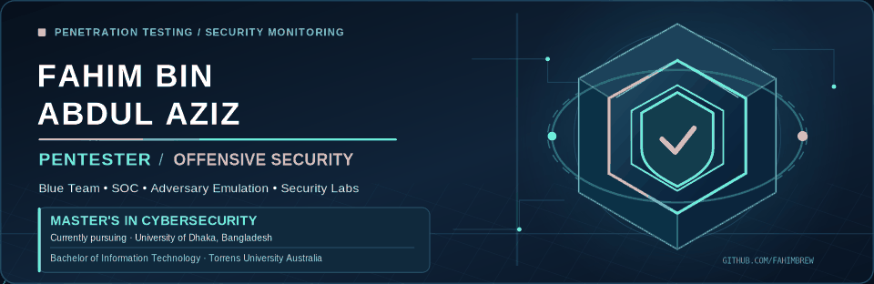
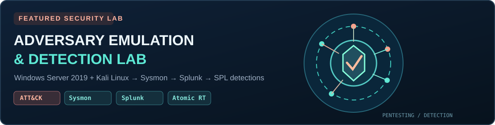
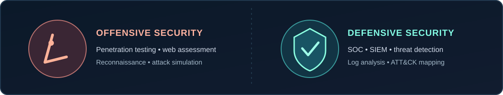

<h3>Penetration Testing · Adversary Emulation · Security Monitoring</h3>

<strong>Currently pursuing a Master's in Cybersecurity — University of Dhaka</strong> 
<strong>Bachelor of Information Technology — Torrens University Australia</strong>

<a href="https://github.com/fahimbrew/Adversary-Emulation-Detection-Lab">Security Lab</a> &nbsp;·&nbsp;
<a href="https://www.linkedin.com/in/fahimbinabdulaziz/">LinkedIn</a> &nbsp;·&nbsp;
<a href="mailto:iftiaqhossain@gmail.com">Email</a>

## About me

I'm Fahim, a **Pentester and cybersecurity enthusiast** currently pursuing a **Professional Master's in Information & Cyber Security at the University of Dhaka**. I hold a **Bachelor of Information Technology from Torrens University Australia**.

My work focuses on **penetration testing, web application security, adversary emulation, and security monitoring**. I enjoy exploring security vulnerabilities, understanding attack techniques, and investigating how suspicious activities appear in system and network logs.

I have hands-on experience with **Burp Suite, Nmap, Metasploit, Kali Linux, Splunk, Wazuh, and Sysmon** through authorized security labs and academic projects. My previous experience in IT support also gave me a practical foundation in **networking, Active Directory, Microsoft 365, and Windows administration**.

I use GitHub to document my security labs, testing methodologies, detection experiments, and technical findings.

## Education

| Qualification | Institution | Dates |
| --- | --- | --- |
| **Master's in Cybersecurity (in progress)** — official program: *Professional Master's in Information & Cyber Security* | **University of Dhaka, Bangladesh** | Jan 2026 – present |
| **Bachelor of Information Technology** | **Torrens University Australia** | Feb 2021 – May 2024 |

## Featured cybersecurity lab

### [Adversary Emulation & Detection Lab](https://github.com/fahimbrew/Adversary-Emulation-Detection-Lab)

I built a **Windows Server 2019 and Kali Linux lab** to practise adversary emulation and defensive investigation. The work uses **Atomic Red Team, Sysmon and Splunk** to generate activity, collect telemetry, and examine it with SPL queries.

| MITRE ATT&CK | What I tested |
| --- | --- |
| `T1053.005` | Scheduled task activity |
| `T1218.005` | `mshta.exe` execution |
| `T1003.001` | LSASS credential-access behavior |
| `T1059.001` | PowerShell execution |
| `T1112` | Registry changes and security-control attempts |

The repository includes lab notes and detection work, with outcomes and limitations documented rather than just screenshots.

## Penetration testing and security skills

**Penetration testing:** Reconnaissance, enumeration, and web application testing in controlled environments. Tools I've used include Burp Suite, Nmap, Kali Linux, Metasploit, Acunetix, Dalfox, ReconFTW, Subfinder, and Assetfinder. My training covers SQL injection, XSS, and file-inclusion vulnerabilities.

**SOC and threat detection:** Academic lab work with Splunk, Sysmon, and Wazuh; working with Windows events, telemetry, investigation, and alert-triage concepts.

**Systems and scripting:** Active Directory, Microsoft 365, VMware, Windows, Linux, Wireshark, PowerShell and Python.

## Other practical work

- **PowerShell and Windows Server:** Scripts for user onboarding, account management, and password-reset exercises.
- **WordPress security:** Restored a local WordPress installation and used Wordfence in a guided malware investigation.
- **Network troubleshooting:** DNS/DHCP connectivity diagnosis and Wireshark packet analysis.
- **Web security training:** Authorized reconnaissance and vulnerability-testing exercises.

I also have a software development background: [Tulip Frontend](https://github.com/fahimbrew/Tulip-frontend) · [Gadget Heaven](https://github.com/fahimbrew/gadget-heaven) · [Chef's Table](https://github.com/fahimbrew/chef-s-table).

## Master's project (proposed)

**Design and Implementation of a Risk-Adaptive Zero Trust Security Framework for Private Cloud Environments**

This is a proposed project for my cybersecurity master's program, not a completed system. I'm planning to study contextual risk scoring, adaptive access decisions, identity management, and security monitoring in a private-cloud lab.

## Professional experience

**IT Support Officer — Alphabyte Technology Ltd** (Aug 2024 – Aug 2025)  
Supported users, endpoints, networking, Microsoft 365, and Active Directory, alongside routine system administration and troubleshooting.

I'm currently preparing for **CompTIA Security+**. My professional interests include penetration testing, SOC analysis, and junior cybersecurity engineering roles.

[LinkedIn](https://www.linkedin.com/in/fahimbinabdulaziz/) · [Email](mailto:iftiaqhossain@gmail.com)
